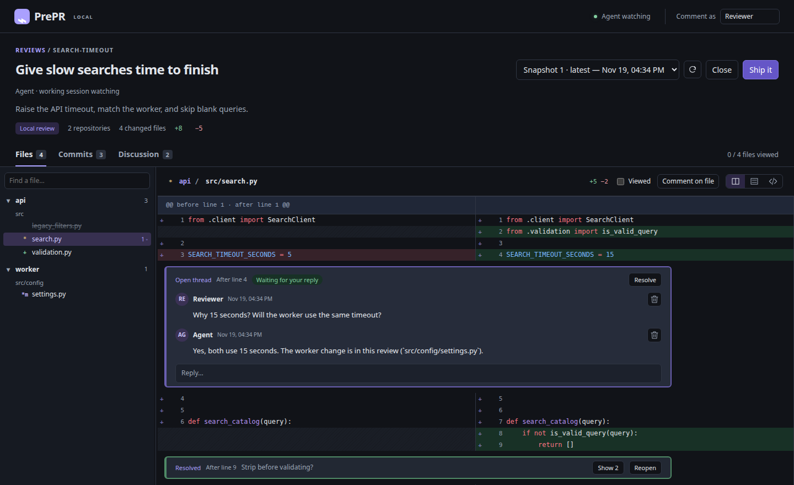
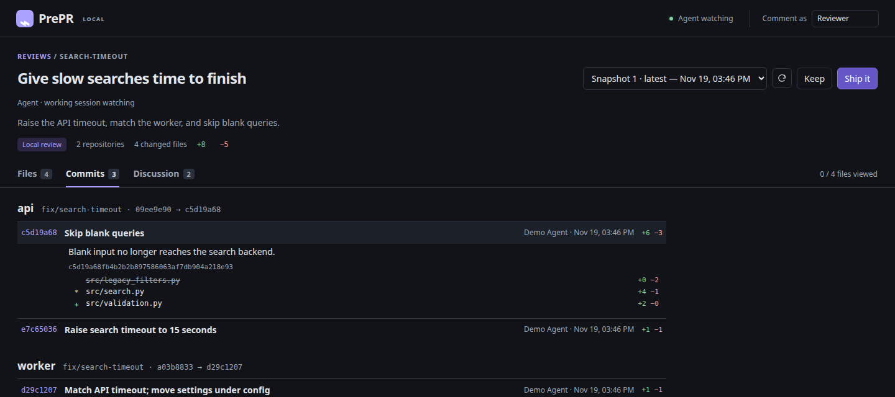
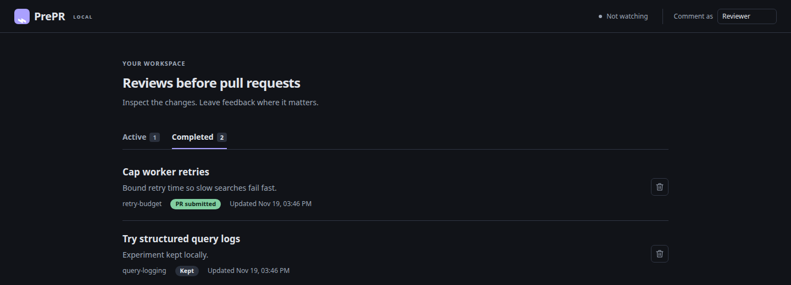

<div align="center">
  
  <p><strong>Review agent work locally, before the PR.</strong></p>
</div>



<p align="center"><sub>Demo code and fictional feedback.</sub></p>

Local review page for coding-agent changes. Agent publishes change set (one or more repos),
opens page, hands review to a background agent. Comment on a line: same CLI (Codex or Claude Code)
starts headless, answers, fixes. **Ship it** makes it open the PRs. No prompting, no chat left
spinning while it waits.

## Setup

Needs Docker with Compose, Git, Python 3.12+. Background agent: Linux or macOS, Codex CLI or Claude Code.

```bash
git clone https://github.com/demo-kode/prepr-tool.git
cd prepr-tool
mkdir -p .local/data
printf 'services:\n  review:\n    user: "%s:%s"\n' "$(id -u)" "$(id -g)" > compose.override.yaml
docker compose up -d --build
```

App listens on **http://127.0.0.1:18744** only. Data in `.local/data`.

Install skill:

```bash
ln -s "$(pwd)/skills/prepr-review" ~/.claude/skills/prepr-review   # Claude Code
ln -s "$(pwd)/skills/prepr-review" ~/.codex/skills/prepr-review    # Codex
```

First agent run asks two things once, stored in `.local/setup.json` (no secrets):
open reviews in VS Code? How to reach your PR platform (GitHub, Azure DevOps, ...)?
Check or change: `python3 review.py setup [--vscode installed|declined] [--pr-platform P --pr-access TEXT]`.

### VS Code

```bash
python3 review.py vscode-install     # build .vsix from vscode/, install, record choice
```

Reviews open in a slicker VS Code tab, page tabs and all. **PrePR** status bar button,
commands **PrePR: Open review…** / **PrePR: Show all reviews**; agent opens
`vscode://demo-kode.prepr/open?review=ID`.
External links go to your browser. Page may be framed only by itself and VS Code.

## Flow

1. Work with agent as usual. Change set ready: agent creates PR branch in each affected repo,
   commits there (local only), writes manifest, publishes, hands review to background agent with
   task context as text, offers to open PrePR. Its chat turn ends there.
2. Accept. Page opens (VS Code tab or browser). Top-right light green: **Agent watching**
   (host runner, no model running). Amber: **Agent working** (writing replies or changing code).
3. Comment on a line (click line number) or whole file.
4. Runner starts same CLI in background for that batch. It replies per thread, fixes code when
   asked, runs checks, commits fix round locally, republishes, exits. Each open thread shows whose turn: *waiting for agent*, *agent writing reply /
   changing code*, *waiting for your reply*. Question threads stay open after the agent answers. Ask a follow-up in the same thread or click **Resolve** when finished. Resolved threads collapse to one line (**Show**).
   The latest diff follows new snapshots automatically. A draft delays the switch until you post or cancel it. Select an earlier snapshot to keep reading that version. Earlier threads stay visible on new code and in
   **Discussion**.
5. Finish, top right:
   - **Close**: stop watching, leave local changes as they are, move review to **Completed**
     (read-only).
   - **Ship it**: background agent pushes PR branches, opens real PRs (one per affected repo) for exact
     snapshot shown. Branch already has an open PR: the push updates it, no second PR. A live overlay shows snapshot verification, branch pushes and PR creation by repository.
     Each repository ends at **PR opened** (new) or **PR updated** (existing PR received the push).
     Hide it to keep reading, or reopen **Submission details** for status and PR links. Never merges or deploys. Done: review moves to **Completed** with green
     **PR submitted** token.

Several tasks at once: each gets own review, watcher and PRs; in VS Code each review gets own tab.
Tasks sharing a repo need own worktree each.

PRs sent from chat instead of **Ship it**: agent runs `review.py mark-sent ID --body 'repo: URL'`
(**PR submitted**). Task dropped in chat: `review.py close ID`.

Home page: **Active** and **Completed** tabs. Completed reviews stay archived until you delete
them (trash icon).

### Background agent

```bash
python3 review.py agent-start REVIEW_ID --manifest review.json --context-file context.md   # agent runs this
python3 review.py agent-status [REVIEW_ID]     # runner up? state, last run log
python3 review.py agent-stop REVIEW_ID         # release review
python3 review.py agent-ensure                 # start runner by hand
```

- Runner: one small host process, no model. Polls local service, keeps watcher slot of each
  recorded review, survives sleep and restarts. Started by `agent-start` (systemd user unit when
  available, else detached); VS Code extension brings it back at window start.
- One CLI conversation per review. First comment batch or Ship it click starts recorded CLI with
  whole context as text (task context from working agent, review, repos, manifest, threads, rules);
  later batches go into that same conversation. Claude Code process stays up between batches; Codex
  runs one process per batch and resumes its thread.
- No leaked CLIs. Waiting CLI ends after 20 minutes without reviewer activity
  (`setup --agent-idle MINUTES`); next comment resumes conversation. CLI ends with the review (Close,
  Ship it result, `agent-stop`), on failed turn, 60 min turn limit, runner stop or crash. Its child
  processes go with it (process group, session and, with systemd, its own cgroup scope). At most 4
  alive. `agent-status` shows live pid.
- Turn answered nothing or recorded no ship result: one retry in a clean conversation, then page shows reason and log path
  with **Start watching** to retry. Logs and prompts: `.local/agents/reviews/ID/runs/`.
- **Start watching** (top bar, beside the indicator, shown while no agent is attached) also attaches a review nobody handed over: recorded CLI, else
  `setup --agent codex|claude`, else first installed. Page says when no runner answers.
- Unattended permissions = each CLI's own automatic approval review: Codex `--approve-for-me`
  (workspace-write sandbox plus local network), Claude Code `--permission-mode auto`. Change:
  `python3 review.py setup --agent-args claude '--permission-mode acceptEdits'`.

No background agent also works: tell agent in chat to read feedback when done commenting.

## Page





| | |
| --- | --- |
| File marks | `+` added · `*` changed · `+m`/`*m` moved · `+c`/`*c` copied (`*` = edited) · ~~struck~~ deleted |
| Keys (file list) | ↑/↓ or W/S prev/next file · →/← or D/A viewed/unviewed |
| Filters | **Hide unchanged moves**, **Hide tests** (both on by default) |
| Views | Split, Unified, Raw (full file). Drag dividers to resize. |
| Tabs | **Files**, **Commits** (per repo, base to HEAD), **Discussion** (all threads) |
| Snapshots | Selector at top. Comments stay on code they were written against. Viewed marks carry over for files unchanged since previous snapshot. |

Moved/copied files compare against original content, also across repos. Header shows
`moved from …` / `copied from …`.

## Manifest (agent writes it)

```json
{
  "id": "search-timeout",
  "title": "Give slow searches time to finish",
  "description": "Adjust the API timeout and worker settings.",
  "repos": [
    {"name": "api", "path": "/abs/path/api", "branch": "fix/search-timeout", "base": "<base SHA>",
     "exclude": ["evidence/**"]},
    {"name": "worker", "path": "/abs/path/worker", "branch": "fix/search-timeout", "base": "<base SHA>"}
  ],
  "comparisons": [
    {"repo": "api", "path": "src/settings.py", "fromRepo": "worker", "fromPath": "shared/settings.py"}
  ]
}
```

- `base`: exact task start commit (merge-base for full PR). Keep across follow-ups.
- Snapshot covers `base` to current worktree: commits, staged, unstaged, untracked files.
- `include` / `exclude`: optional path globs. `branch` checked, never switched.
- `comparisons`: optional explicit source for copy or ambiguous move.

```bash
python3 review.py publish review.json           # new snapshot (identical content is reused)
python3 review.py feedback REVIEW_ID --open     # read open threads
python3 review.py open REVIEW_ID                # VS Code tab if installed, else browser
```

## Data

Snapshots hold your source code; `.local/agents` holds task context, prompts, run logs. Keep `.local` private, untracked. Keep service on loopback:
no authentication. Reviews survive container rebuilds.

## Development

```bash
python3 -m unittest discover -s tests
```

Browser tests (`tests/*.cjs`) need Playwright and disposable server:
`PREPR_DATA=/tmp/prepr PORT=18745 python3 server.py`, then `node tests/sidebar.cjs` etc.
Extension logic: `node tests/vscode-extension.cjs` (no VS Code needed).
Never run against real service.
